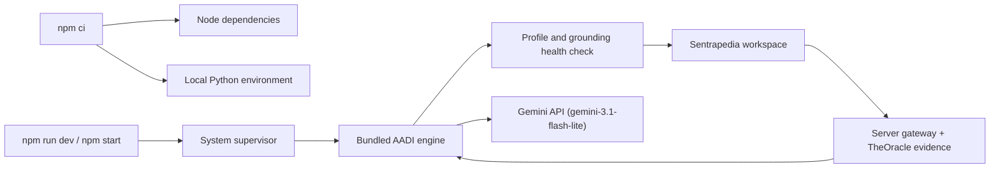

# AADI inside Sentrapedia

Current runtime contract, 2026-10-10: AADI is installed and launched as part of
Sentrapedia. The previous external-repository setup is superseded.

Host prerequisites: Node24+, Python3.11+. Docker includes both. Install once with
`npm ci --workspaces=false`; set `GEMINI_API_KEY` in the environment or capsule
`.env.local`; run `npm run dev` (not `npx next dev`, which starts no engine). For an optimized local build use `npm run build`
then `npm start`. Default workspace: http://127.0.0.1:3101. `PORT` and
`SENTRAPEDIA_HOST` override the local web listener.

`aadi/service` owns model calls, contract checks, privacy checks, budget/audit and
postchecks; `aadi/common` owns provider/data policy and call guards.
`scripts/install-aadi.mjs` owns the capsule-local environment and pinned package
installation. `scripts/run-system.mjs` owns startup, ephemeral loopback port,
per-run token, readiness and shutdown. Windows child guardians use Job Objects
and parent monitoring; POSIX cleanup handles INT/TERM/HUP process groups.
`scripts/build-system.mjs` stages engine, launcher, TheOracle index and model and static assets into the
standalone output. `src/lib/theoracle-grounding.ts` owns readonly TheOracle vector retrieval; the query is
embedded locally on CPU with the model recorded in `theoracle/index/manifest.json`.
`npm ci` also downloads that pinned model once (about 1.2 GB) into `theoracle/model/`.

The internal engine is a Python process managed by the application lifecycle.
No external `-AadiRoot` switch, source checkout, shared service, manually supplied service
token, or another project's environment is used (`scripts/run-aadi.ps1` forwards directly to `scripts/run-system.mjs`). Old `.env.local` service URL/token
values are overridden in memory. The provider is still an external model API.
Startup reads the model's metadata from the Gemini API with the key
(`preflightProvider` in `scripts/aadi-runtime.mjs`): a rejected key or an unknown
model stops startup without a retry. The request carries no case data and sends no
completion, so install, startup and health checks cost nothing.

Source license and hashes are in `aadi/LICENSE` and `aadi/SOURCE.json`. The exact
routine prompt and planning schema snapshots avoid importing research FHIR/ML
dependencies; regression tests verify their original text hashes. Runtime engine,
prompts, privacy, postchecks and contracts retain approved source bytes. The
simulation runner is retained only as attributed text for policy regression tests,
not offered as a runtime feature.

Build output can run with `node scripts/run-system.mjs standalone` after installing
its Python lock using `node scripts/install-aadi.mjs --production`. Docker performs
this installation and uses the same supervisor. Runtime secrets are injected at
launch, never built into the image. The audit ledger records metadata and `requestSha256`/`responseSha256` hashes (never the raw case text) and prunes files older than 14 days at engine start; preserve `.runtime/aadi-deepseek/audit` when
moving an existing local installation so today's budget ledger is retained.

Since 2026-10-26 the application no longer declares cases synthetic: the engine runs
under `AADI_DATA_POLICY=openai-standard-retention` and input must carry no patient identity. Local
packaging does not add production authentication or establish clinical accuracy.
Historical inference timings predate this packaging change. See the dated
verification report for fresh install/build/run evidence and remaining limits.

## Analysis progress

Since 2026-11-26 (Gaffer: "A + B: tahap nyata + reveal halus") the workspace shows the gateway's real stages while an
analysis runs. Model text is deliberately not streamed: the engine returns one structured result per step, and the
gateway and then the browser validate it and run the dose evidence gate before anything is shown. Streaming text
would put unvalidated, ungated doses on screen.

- Opt-in: the workspace sends `Accept: application/x-ndjson, application/json` to `POST /api/aadi`. Without that
  header the reply is unchanged.
- Streamed reply: status 200, `Content-Type: application/x-ndjson`, `Cache-Control: no-store, no-transform`,
  `X-Accel-Buffering: no`; one JSON object per line.
  - `{"type":"stage","stage":S,"state":"running"|"done"|"failed"}`, S one of `retrieve_dx`, `aadi_dx`, `retrieve_tx`,
    `aadi_tx`, `gate`. Nothing else: no case text, output, cost, error codes or timings.
  - Last line `{"type":"final","status":N,"body":B}`: exactly the status and body the plain reply would carry,
    refusals included. The browser validates and gates B as before.
- Code: `src/lib/aadi/stage-stream.ts` (writer and reader), `step(request, principal, onStage)` in
  `src/lib/aadi/gateway.ts`, wait card `src/components/thinking-card.tsx`. Tests: `tests/aadi-stage-stream.test.ts`,
  `tests/ui/thinking-card.test.tsx`.
- Not yet verified: that Cloudflare Access in front of the beta server passes the lines through as they are written.
  If it buffers, all stage lines arrive with the answer and the card behaves as before.

On arrival the answer and the document pane come in through one view transition (`smooth(update, "arrive")`): the chat
column, composer and header tools glide to their new width, and the analysis's sections rise in 60 ms apart. A fresh
answer is scrolled to its top. Under reduced motion everything appears at once (`tests/ui/answer-arrival.test.tsx`).
